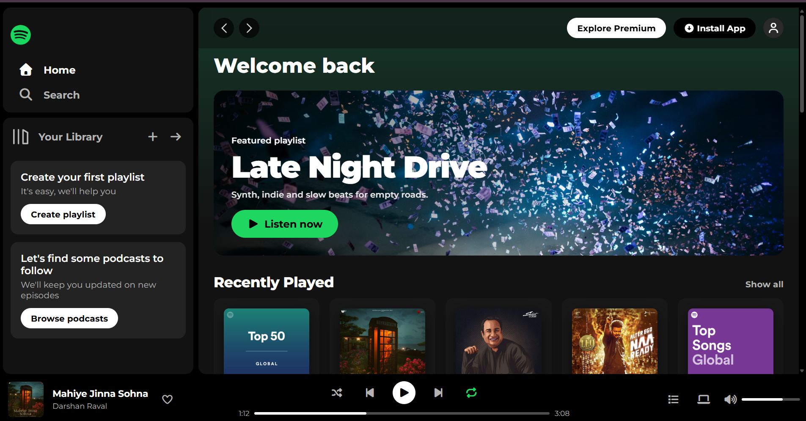
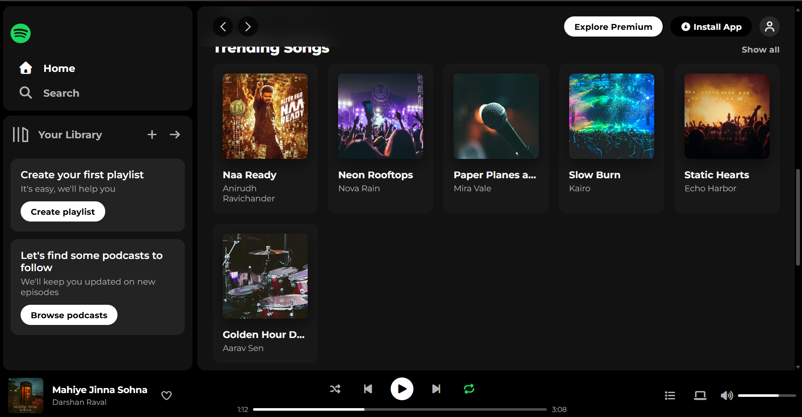
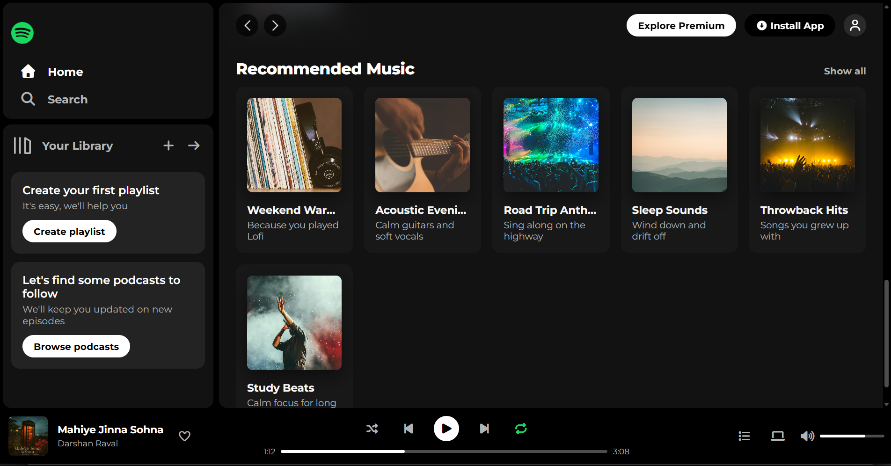

# 🎧 Spotify – Frontend Clone

A modern **Spotify-inspired music streaming interface** built using HTML5 and CSS3. This project recreates the look and feel of Spotify with a clean layout, music cards, playlists, artist pages, and a bottom music player.

## ✨ Features

- 🏠 **Home Page** – Explore featured playlists, albums, and music.
- 🔍 **Search Page** – Spotify-inspired search bar and browse categories.
- 📚 **Your Library** – A dedicated library interface.
- 🎵 **Playlist Page** – Display playlists and track listings.
- 🎤 **Artist Page** – Artist profile and music sections.
- 🎨 **Modern UI** – Clean design with smooth hover effects and transitions.
- 📱 **Responsive Design** – Layout adapts to different screen sizes.
- 🎧 **Music Player UI** – Playback controls, progress bar, and volume section.

## 📸 Dashboard Preview

<p align="center">
  
  
  
</p>

## 📸 Application Screenshots

<details>
<summary>🎵 View More Screenshots</summary>

### Dashboard View 2

<p align="center">
  
</p>

### Dashboard View 3

<p align="center">
  
</p>

</details>

## 🛠️ Technologies Used

- HTML5
- CSS3
- Font Awesome
- Google Fonts (Montserrat)

**Note:** This version is built using HTML and CSS only. Music playback, search functionality, and other dynamic features are currently UI representations and are not fully functional.

## 📂 Project Structure

```text
Spotify-frontend-clone/
│
├── index.html
├── search.html
├── library.html
├── playlist.html
├── artist.html
│
├── css/
│   ├── base.css
│   ├── layout.css
│   ├── components.css
│   ├── player.css
│   └── responsive.css
│
├── assets/
│   ├── icons/
│   └── images/
│
├── Screenshot/
│   ├── Dashboard-1.png
│   ├── Dashboard-2.png
│   └── Dashboard-3.png
│
└── README.md
```

## 🚀 How to Run Locally

1. Clone this repository:

   ```bash
   git clone https://github.com/ssanskruti17-tech/Spotify-frontend-clone.git
   ```

2. Open the project folder in VS Code.
3. Open `index.html` in your browser.

   **Recommended:** Use the Live Server extension in VS Code.

## 🔮 Future Improvements

- Add JavaScript for functional music playback.
- Implement working search functionality.
- Add interactive playlist controls.
- Integrate a music API.
- Improve user interactions and accessibility.

## 🎯 What I Learned

Through this project, I practised:

- Structuring webpages using HTML.
- Styling interfaces using CSS.
- Working with Flexbox and CSS Grid.
- Creating responsive layouts.
- Designing reusable UI components.
- Organizing a multi-page frontend project.

## 👩‍💻 Author

**Sanskruti Sonawane**

- GitHub: [@ssanskruti17-tech](https://github.com/ssanskruti17-tech)

---

⭐ If you like this project, consider giving it a star!

*Built with ❤️ and code.*

**Disclaimer:** This is an educational Spotify-inspired frontend project and is not affiliated with or endorsed by Spotify.
